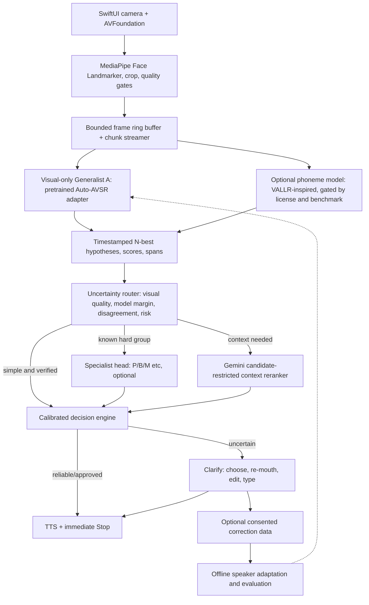

# Silent Speech — Codex Master Build Specification

**Version:** 1.0  
**Date:** October 26, 2026  
**Target:** iOS camera-first assistive communication for people who can normally move their lips, tongue, and jaw to articulate speech but cannot produce usable audible speech.  
**Status:** Engineering plan. No model performance, streaming functionality, or assistive reliability is assumed proven.

---

# 0. MASTER INSTRUCTION TO CODEX (READ FIRST)

You are the lead implementation engineer for **Silent Speech**, a camera-based, visually decoded, personalized communication aid. Build the real product incrementally with **working code and executable tests**, not a pitch deck, paper architecture, or impressive-looking simulation. Accuracy, user control, low latency, privacy, and graceful failure are the priorities.

**Do not train a lip reader from scratch.** Reuse strong visual-only speech recognition checkpoints, adapt them to silent articulation and individual users, and add specialized error-recovery components only where they measurably improve communication.

**Important:** `Auto-AVSR`, `VALLR`, `Gemini`, and optional TTS are separate components with potentially different licenses and runtime constraints. An architectural reference is not evidence that a checkpoint is deployable. Investigate and report availability, weight provenance, exact version, GPU/CPU needs, and commercial permissions before using each external asset. No unlicensed model weights or datasets in the repository.

**Execution protocol:**
1. Read this entire file and inspect the local workspace before writing code.
2. Implement **one phase at a time**, starting at Phase 0. Each phase has explicit validation gates below.
3. Before each phase: write a short plan and the files to modify. After each: run tests, capture actual outputs, summarize what works, and record unresolved blockers.
4. Maintain `docs/PROGRESS.md`, `docs/DECISIONS.md`, `docs/MODEL_REGISTRY.md`, `docs/KNOWN_LIMITATIONS.md`, and `docs/TEST_REPORT.md`. Record commands and their real observed results, not claims.
5. Stop at a gate requiring human hardware, credentials, model access, clinical/user data, or a license decision. Provide the exact next action. Do **not** replace a missing real component with a fake response or mark it complete.
6. A separate `DEMO_MODE=true` may generate **clearly labeled synthetic fixture outputs** for UI tests; `REAL_MODEL=true` must fail explicitly if valid model weights are unavailable. No hidden fallback from real to simulated recognition.
7. For each change, add relevant unit/integration/regression tests. Keep the app building, linting, and deployable after each phase. Use strict types and machine-readable contracts.
8. Never transmit audio or video without an explicit user action and recorded consent. Default to ephemeral video buffers; don't retain facial recordings, embeddings, transcripts, or corrections except as explicitly authorized.
9. Do not claim medical efficacy, frontier recognition quality, sub-second response, or production readiness until independently measured on the intended population.
10. Prioritize delivering a **working end-to-end vertical slice** over developing several incomplete sophisticated models.

At the end of **each** phase, respond with:
```
PHASE: <number and name>
STATUS: PASS | PARTIAL | BLOCKED
IMPLEMENTED: <concrete files/features>
VALIDATION: <actual commands and results>
LATENCY: <measured values or NOT MEASURED>
ACCURACY: <measured values or NOT MEASURED>
BLOCKERS: <specific>
NEXT PHASE: <what to do next>
```

Do not automatically proceed past **Phase 2's real-inference validation** or **Phase 5's user-data/training validation** without reporting the gate to the developer. For the initial Codex session, execute Phase 0 and Phase 1, then attempt Phase 2 only if suitable weights and hardware are already accessible; otherwise clearly mark it blocked and leave usable scaffolding.

---

# 1. Product definition and non-negotiables

## Primary user
A person who has adequate voluntary lip/jaw articulation but cannot produce reliably intelligible audible speech. This **does not** assume all users have the same facial movement, endurance, articulation timing, or personal vocabulary.

## Core experience
1. User opens iPhone app and positions camera on face (front camera initially).
2. UI shows a minimal framing guide and confirms face/mouth tracking quality.
3. User mouths a sentence silently.
4. System streams/records a short, bounded mouth video and returns **candidate transcriptions**, preserving uncertainty.
5. When sufficiently reliable, the app offers or speaks the intended text according to **user-selected speech mode** (default requires approval for unknown/unverified utterances). When uncertain, app presents a quick choice, repeat-mouthing, editing, or type-to-speak.
6. Optional confirmed corrections personalize the system when the user explicitly opts in.
7. A stop button immediately cancels queued and ongoing speech. App remains a useful AAC fallback when the camera/network/models fail.

## Product principles
- **Never override the person's intended meaning with fluent but ungrounded LLM completion.** Names, negations, numbers, consent, directions, and emergency phrases are especially important.
- Optimize **successful intended words per minute**, not only raw WER. Track erroneous speech uttered aloud and correction burden.
- Explicit separation of `provisional`, `confirmed`, `spoken`, and `cancelled` states. Never speak a provisional result without the user's opt-in to a defined auto-speak policy.
- Never imply all P/B/M words can be separated visually; some are fundamentally indistinguishable.
- Provide type-to-speak, saved phrases, undo, edit, repeat, stop, and offline fallback.
- Accessible controls: large tap targets, VoiceOver labels, Dynamic Type, switch accessibility where feasible.

## Out of scope until validated
Clinical claims; neural decoding; actual facial-muscle EMG hardware; fine-tuning Gemini; automatic external posting/sending; comprehensive voice cloning; arbitrary unconsented data collection.

---

# 2. System architecture



**Operational simplification:** one real, reliable generalist plus clarification is the first production-capable slice. The phoneme branch, specialists, personalized visual adapters, Gemini, and additional TTS provider are **feature-flagged additions**, not critical-path dependencies for the first working prototype.

**Latency architecture:** Implement an incremental framing/transport/UI pipeline immediately. **Do not call an offline model a streaming model.** If the loaded generalist requires the full clip, accumulate the clip, mark final predictions only after endpoint, and honestly measure its actual delay. Replace it or distill a causal/chunked student only after evaluation proves an acceptable quality–latency tradeoff.

---

# 3. Repository structure

Create this repository unless the current workspace already has useful files; preserve existing code and adapt the structure.

```
silent-speech/
├── README.md
├── AGENTS.md
├── .env.example
├── .gitignore
├── Makefile
├── pyproject.toml                # uv-managed Python project; lockfile committed
├── uv.lock
├── docker-compose.yml
├── .github/workflows/ci.yml
├── configs/
│   ├── app.yaml
│   ├── model_registry.yaml
│   └── thresholds.yaml           # experimentally determined, defaults conservative
├── apps/
│   └── ios/SilentSpeech/          # Xcode/SwiftUI project or XcodeGen project.yml
│       ├── App/
│       ├── Features/Capture/
│       ├── Features/Transcript/
│       ├── Features/Clarification/
│       ├── Features/Speech/
│       ├── Features/Settings/
│       ├── Services/
│       ├── Models/
│       └── Tests/
├── backend/
│   ├── app/main.py
│   ├── app/api/{health,session,inference,feedback}.py
│   ├── app/contracts/{events,predictions,consent}.py
│   ├── app/capture/{framing,quality,buffer}.py
│   ├── app/models/{base,auto_avsr,vallr,registry,mock}.py
│   ├── app/pipeline/{orchestrator,endpointing,uncertainty,router,fusion}.py
│   ├── app/context/{gemini,hotwords,schemas}.py
│   ├── app/experts/{base,bilabial,registry}.py
│   ├── app/speech/{base,local,cartesia}.py
│   ├── app/security/{auth,consent,retention}.py
│   ├── app/telemetry/{latency,events}.py
│   └── tests/
├── research/
│   ├── datasets/{schemas,manifests,splits}/
│   ├── scripts/{benchmark_vsr,evaluate,prepare_silent_data}.py
│   ├── training/{speaker_adapter,bilabial_expert,reranker,calibrator}/
│   └── reports/
├── fixtures/
│   ├── synthetic_events/
│   └── README.md
├── scripts/{bootstrap,dev,check,benchmark}.sh
└── docs/
    ├── ARCHITECTURE.md
    ├── RUNBOOK.md
    ├── API_CONTRACT.md
    ├── MODEL_REGISTRY.md
    ├── DATA_GOVERNANCE.md
    ├── DECISIONS.md
    ├── PROGRESS.md
    ├── KNOWN_LIMITATIONS.md
    └── TEST_REPORT.md
```

**Stack**
- **iOS:** SwiftUI, AVFoundation (`CMSampleBuffer`/`CVPixelBuffer`), MediaPipe Tasks Vision Face Landmarker in live-stream mode, URLSession WebSocket, AVSpeechSynthesizer initial fallback, AVAudioEngine/provider adapter when streaming remote TTS.
- **Backend:** Python 3.11+ where supported by model dependencies; `uv`; FastAPI, Pydantic v2, PyTorch in isolated inference environment where version conflicts require it, WebSocket framing, pytest, ruff, mypy, pydantic-settings, structured telemetry.
- **Model execution:** CUDA GPU recommended for full-size pretrained models; CPU mode must clearly disclose slowness. Support model-process isolation (a worker API) if different checkpoints need incompatible Python/Torch versions.
- **Cloud:** single development GPU worker first; avoid Kubernetes/Kafka/microservices until measurements demand them.
- **No secrets in code:** Gemini/TTS API keys only on server, never bundled in the app. `.env.example` contains placeholders only.
- **Dependency discipline:** pin compatible package versions and commit lockfiles. Don't guess APIs: inspect real installed packages and upstream reference examples.

---

# 4. Canonical contracts, events, state machine

## Server interfaces
- `GET /healthz`: process liveness; no claim that models are ready.
- `GET /readyz`: explicitly lists `generalist_ready`, `expert_ready`, `gemini_ready`, `tts_ready`, `mode` (`demo` or `real`), model/checkpoint IDs, and reasons for missing readiness.
- `POST /v1/sessions`: create authenticated/ephemeral session; negotiate user consent, capture FPS and frame encoding, requested language, auto-speak policy, privacy mode. No raw video uploads without consent.
- `WS /v1/sessions/{session_id}/stream`: bidirectional session messages and timestamped binary frame chunks. JSON metadata control frames; binary video bytes or preprocessed crops; **no per-frame base64 in JSON**.
- `POST /v1/sessions/{session_id}/confirm`: explicitly approve selected or edited text.
- `POST /v1/sessions/{session_id}/cancel`: cancel inference and current/pending speech; WebSocket cancellation should be supported too.
- `POST /v1/sessions/{session_id}/feedback`: explicit opt-in correction event; separately ask consent to retain this example for training.
- `GET /v1/models`: installed model metadata, license/readiness and modes (do not publish secrets/paths).

## Canonical typed prediction
```json
{
  "session_id": "uuid",
  "utterance_id": "uuid",
  "revision": 4,
  "state": "provisional",
  "source": "auto_avsr",
  "is_demo": false,
  "text": "I want to go to the bark",
  "candidates": [
    {"text": "I want to go to the bark", "raw_score": -4.8, "score_type": "log_probability"},
    {"text": "I want to go to the park", "raw_score": -5.0, "score_type": "log_probability"}
  ],
  "uncertain_spans": [
    {"start_ms": 1040, "end_ms": 1390, "alternatives": ["bark", "park"], "group": "bilabial"}
  ],
  "timing": {"capture_end_ms": 2400, "server_received_ms": 2535},
  "decision": "needs_clarification",
  "calibrated_probability": null
}
```

`raw_score` is **not automatically a probability**. Record `score_type`, calibration version, and encoder/decoder variant. If N-best alternatives or word timings aren't exposed by a checkpoint, use `null` and explicitly mark capability unsupported; do not fabricate them.

## Streaming events
`session_ready`, `capture_quality`, `utterance_started`, `partial_hypothesis`, `final_candidates`, `expert_result`, `context_result`, `decision`, `clarification_required`, `user_confirmed`, `tts_started`, `tts_chunk`, `tts_done`, `cancelled`, `error`. Each message includes `schema_version`, `session_id`, `utterance_id`, monotonic event timestamp, and `revision`. The client ignores stale revisions and prevents speaking obsolete predictions.

## Client message state machine
`idle -> tracking -> articulating -> processing -> proposed -> confirmed -> speaking -> finished` with branches `clarification_required`, `cancelled`, `network_error`, and `manual_entry`. Capture and inference can overlap; state machine refers to *utterance state*, not mutually exclusive worker threads.

Invariants:
- A `provisional` result cannot become `spoken` except through user's configured policy or explicit confirmation.
- Default policy for unvalidated model = confirm-before-speak.
- `cancel` prevents queued speech and stops active playback promptly.
- Model/Gemini failure never blocks type-to-speak.
- Never alter explicitly typed or user-confirmed text via Gemini.

---

# 5. Models: actual integration plan

## Generalist A (first real model): Auto-AVSR
Reference: `https://github.com/mpc001/auto_avsr`
- Use **visual-only (`modality=video`)**. Do not accidentally run ASR/audio mode or report audio recognition as lip-reading performance.
- Repository describes pretrained visual-only LRS3 model `vsr_trlrs2lrs3vox2avsp_base.pth` with 20.3% published LRS3 WER and ~250M parameters. These are published benchmark numbers, not our results and not target-user silent articulation performance.
- Implement `VisualSpeechRecognizer` interface: `load()`, `preprocess(video)`, `predict(video, options) -> RecognitionResult`, `capabilities()`, `health()`, `close()`.
- Normalize mouth-region frames to the exact training preprocessing expected by the checkpoint, including coordinate orientation, scaling, padding, frame rate, and color/grayscale. Maintain a reproducible golden preprocessing test.
- Provide a real inference CLI on an authorized real clip. Store checkpoint in ignored external model cache, not Git.
- Respect code Apache-2.0 and **separately verify model weight/data rights** before commercial use.
- Initially treat it as utterance-level/offline until streaming support has been demonstrated with the actual checkpoint.

## Generalist B (research/conditional): VALLR-style phoneme model
Reference: `https://github.com/MarshallT-99/VALLR`
- Research reference for `video -> phoneme sequences -> language reconstruction`.
- Check checkpoint availability, precise inference API, phonetic output accessibility, and repository/weight licenses before integration. Repository is published as noncommercial research; **do not ship it commercially without rights**.
- Under a feature flag, use a compatible and properly licensed phonetic model or independently implemented architecture if appropriate. Do not download an unverified repo and imply deployability.
- Run both generalists on identical test clips; keep B only if accuracy gains justify latency/cost.

## Personalized adaptation
- Start with an opt-in per-user visual adapter with frozen core network where technically supported. This may need layer-specific adapter support; do not assume `LoRA` drops into an arbitrary VSR checkpoint.
- Train only with labeled clips + consent. Evaluate across **held-out sessions** of the same speaker, then independent users. Baseline against the exact unadapted model.
- Preserve per-user checkpoint version, deletion control, rollback, and metadata. Never opportunistically retrain during conversation.

## Confusion specialists (later, ablation-gated)
- First expert handles P/B/M-style bilabials; then add F/V etc **only if measured**.
- Prefer a shared pretrained visual encoder + narrow temporal classification/ranking head. Train against **the actual near-tie/error distribution** of the primary recognizer. Include hard negatives, balanced class counts, multiple speakers, and both voiced vs truly silent cohorts.
- Input: short video span with coarticulation context, N-best candidate set, span quality, user adapter ID. Output: per-candidate *evidence* + `abstain` capability, provenance, calibration version. Never claim the video contains direct EMG/muscle activation.
- Evaluate specialist alone **and** its net effect on the entire pipeline. Measure repairs minus damages; do not claim improvement just because isolated accuracy rises.

## Gemini context reranking
- **Not** the primary lip-reader. Input: candidate texts, scores described with correct semantics, neighborhood of context, opt-in personal hot words. By default do not send raw facial frames.
- Use official current server SDK with supported structured-output mode; validate with Pydantic.
- Restrict selection to existing candidates or return `OTHER/ABSTAIN`; never change negation, names, quantities, identity, or important semantics merely to improve fluency. If no candidate fits, request retry/redecode or clarification.
- Timeout, circuit breaker, rate limit, and fallback to local candidate ranking. Dynamic vocabulary retrieval first; no fine-tuning until relevant benchmark shows it helps.
- Do not use an LLM-generated confidence percentage as calibrated uncertainty.

## Confidence/decision engine
- Initially a **conservative rule-based policy** (quality pass, raw-score margin, model agreement, risk words, forced-confirm setting). Not pretend-calibrated.
- After collecting held-out labeled examples, learn a lightweight classifier/calibrator using raw model scores and specialist/context evidence. Use temperature scaling / isotonic/logistic calibration as justified by data; evaluate ECE/Brier score, selective risk, coverage and decision cost.
- `accept`, `revise`, `clarify`, `retry`, `manual_entry` are possible decisions.

## TTS
- First working version: native `AVSpeechSynthesizer` with voice selection, adjustable rate, stop/cancel.
- Optional server-backed low-latency premium voice using provider streaming (e.g. Cartesia WebSocket), requiring explicit user selection; preserve ability to switch instantly to native TTS.
- Any voice cloning of the user must be explicitly authorized, require appropriate reference recordings and service permissions, and must not be prerequisite for core AAC.

---

# 6. Data design, privacy and evaluations

## Data categories
1. **Public benchmark data:** only if license permits access/use; obey dataset speaker privacy, use restrictions, and train/test splits.
2. **Self-recorded silently mouthed clips:** consented adult volunteer prototype dataset, with accurate phrase-level labels and metadata.
3. **Target-user data:** separately consented, optionally retained, representative of actual use; accessible recruitment/validation methods and input from an AAC/speech-language specialist.
4. **Corrections:** only if user opts in to storing for personal tuning or research; anonymization alone does not make facial video non-identifying.

## Dataset manifest (one row per utterance)
```
clip_id, participant_id_pseudonym, session_id, filepath, transcript,
is_silent_articulation, language, fps, resolution, device, lighting,
angle, articulation_duration_ms, consent_scope, label_source,
verification_status, split, acquisition_date, checksum
```

Never commit real faces or private transcripts to a public repo; only artificial/synthetic events in `fixtures/`. Separate participant-disjoint and session-disjoint evaluations. Keep target-population silent-speech evaluation distinct from voiced-speech benchmarks.

## Model evaluation
- WER / CER, sentence exact match, rare-word/name/number/negation errors.
- Candidate oracle top-k recall: is correct phrase available in model alternatives?
- Precision of `accept` decisions, false-accept rate, unnecessary clarification rate, correction-repair vs correction-damage counts.
- Correct intended words per minute **including correction time**; unintended audible utterances per 100 sessions.
- Speaker-held-out, session-held-out, illumination/angle/motion, network, and fatigue robustness.
- Track model and dataset versions, seeds, preprocessing steps, error bars, and cohort definition.
- No claims of clinical efficacy without appropriate validation.

---

# 7. Latency and streaming engineering

**Latency is a critical product requirement, not an assumption of existing checkpoints.** Instrument every span and report medians and p95/p99 separately.

## Engineering targets (not verified performance)
| Metric | Stretch/initial target | Measurement |
|---|---:|---|
| Camera capture | 30 FPS sustained | On target iPhone, thermals/battery included |
| Provisional text refresh | 200–500 ms *if compatible model is streaming* | First/changing hypothesis age |
| Fast-path first audio after mouth stops | median < 800 ms; p95 < 1.5 s | End-of-articulation to first audible output |
| Context/specialist first audio | target < 2 s | End-of-articulation to first audible output |
| Stop/cancel response | as immediate as platform allows; measure p95 | Button to audio silence |
| Accuracy gate | Must improve or preserve measured target-user quality | Same clips, same cohorts |

No requirement above should be marked PASS merely because synthetic fixtures meet it. Offline Auto-AVSR likely requires completed utterances; measure honestly and investigate true incremental model or student distillation if necessary.

## Implementation rules
- Preallocate bounded ring buffer (configurable length e.g. 8–12 seconds); drop old frames predictably and log frame-drop count without sensitive video.
- Separate camera, landmark processing, encoding, networking, inference, routing, and audio playback in different queues/tasks.
- Prefer normalized mouth crops compressed and batched, not raw full-frame uploads or base64 JSON. Negotiate crop size and codec by measured quality. Preserve frame timestamps and orientation.
- Use chunk overlap/context to avoid cutting word boundaries. Track capture time, network time, model queue wait, preprocessing, forward pass, decoding, Gemini, decision, TTS first-byte, audio first-play.
- Endpoint via camera-based motion+stability or manual stop. Don't reuse an **audio** VAD on silent input. Err toward an explicit Done button initially; later validate hands-free segmentation.
- Cancel stale work when utterance revision changes. Prewarm authorized models and TTS; reuse connections.
- For Gemini and specialists, parallelize conditionally; don't trigger every expert per word.
- Use bounded per-user queues and backpressure; on overload degrade to one generalist, then clarification/manual entry. Never queue multiple old utterances to be spoken late.

---

# 8. Security, safety, deployment and user control

- Require transport encryption in deployed environments; local developer HTTP allowed only with clearly documented restricted dev config.
- Authenticate production session endpoints and authorize user-specific adapters. Protect WebSocket handshake and tokens, rate limit uploads, validate maximum frames, crop sizes, duration, MIME and session lifetime.
- Do not log face crops, raw facial landmarks, transcripts, names, personalized vocabulary, facial embeddings, or API keys by default. Record aggregate timings and de-identified error codes. Make debug recording opt-in and time-limited.
- Keep face video in memory only by default. If the user explicitly opts in to local/personalized storage, encrypt, disclose retention, allow export/deletion, and handle crash dumps securely.
- Provide privacy settings: camera status indicator, cloud processing disclosure, training-data sharing opt-in independent of core app consent, delete-my-data action, no surprise history retention.
- Prevent LLM external text from executing instructions or requesting personal data. Sanitize hot words; limit model output to candidate selection and schema.
- TTS must honor stop/cancel, user approvals, screen state and latest utterance revision. Prevent stale responses from speaking after the user edits or cancels.
- Default safety mode for early prototype: confirmation before speaking. Explore a user-selectable auto-speak mode only after calibration and user testing.
- Distinguish prototype, research study, and commercial deployment. Review regulatory, accessibility and data-law obligations with qualified counsel and clinicians before broad release.

---

# 9. PHASED BUILD PLAN WITH VALIDATION GATES

## PHASE 0 — Workspace audit and executable scaffold
**Tasks**
1. Inspect directory for existing files, Xcode projects, env vars (do not display secret values), available tools (`xcodebuild`, Python, GPU/CUDA, `ffmpeg`). Do not overwrite existing project.
2. Create repository structure, `AGENTS.md`, docs, Makefile, Python lockfile, lint/test tooling, `.env.example`, `.gitignore`, CI workflow, `README` with commands.
3. Define Pydantic event and prediction schemas, `VisualSpeechRecognizer` and provider interfaces; config/feature flags.
4. Build FastAPI health/readiness endpoint and deterministic synthetic-fixture demo endpoint.
5. Add initial tests for schema serialization, readiness, no-video data leakage and demo mode labeling.
**Gate:** `make lint`, `make test`, `make api-dev` + `curl /healthz` succeed in actual environment. If Xcode not available, report iOS as unverified, not successful.

## PHASE 1 — iPhone camera, tracking and accessible AAC UI
**Tasks**
1. Create SwiftUI app with `Capture`, `Transcript`, `Clarification`, `Voice`, `Settings` screens.
2. Implement front-camera AVFoundation capture, orientation/mirror handling, permission prompts, bounded in-memory buffer and explicit begin/end articulation buttons.
3. Integrate MediaPipe Face Landmarker live-stream mode; track quality and crop around mouth, with visually understandable guidance. Do not block capture on every model callback.
4. Implement networking with mock backend fixtures, event revision handling and reconnect UX.
5. Working manual type-to-speak, stop/cancel, saved phrases and transcript editing; VoiceOver descriptions.
6. No webcam/video upload until explicit capture+cloud permission. Display when remote model is active.
**Gate:** Build on simulator if possible and physical iPhone for actual camera path; prove `capture -> mouth crop -> upload -> displayed fixture candidate -> user selects -> native TTS`; verify no fixture is labeled as real recognition. Test denied camera permission, missing face, network loss, rapid cancel.

## PHASE 2 — Real pretrained visual-only model (mandatory validation checkpoint)
**Tasks**
1. Inspect Auto-AVSR repo, license and model zoo; write model registry with exact commit, checkpoint checksum, license status, expected preprocessing, supported hardware.
2. Download the appropriate authorized checkpoint into external ignored cache; do not distribute it in repo.
3. Implement compatible real visual-only preprocessing exactly as model needs. Build `AutoAVSRRecognizer` adapter with a working command-line inference smoke test on an authorized real clip.
4. Integrate into backend inference pipeline; return actual predicted text and raw score metadata when present. Mark unknown score capabilities explicitly.
5. Benchmark (a) an authorized public eval clip, (b) a self-recorded **truly silent mouthing** clip, and (c) end-to-end phone-to-backend latency. No audio leakage in model input.
6. Integrate user transcript confirmation. If no checkpoint/GPU available, return `model_not_ready`, keep type-to-speak functional and report exact blockers.
**Gate (HUMAN REVIEW):** Show **actual raw predicted transcripts**, exact inference commands, hardware, timings, model provenance, and test output. Do **not** continue to model training before this gate is reviewed.

## PHASE 3 — Quality/uncertainty and conversational state
**Tasks**
1. Build robust manual utterance endpointing initially. Add optional vision-motion endpoint detector only with ablation tests.
2. Add N-best extraction **only if the model exposes it**; otherwise track what is supported and implement an alternative grounded uncertainty method.
3. Implement conservative, auditable uncertainty and risk policies, per-utterance revision state, cancellation, and clarification UI.
4. Implement `clarify / re-mouth / type / accept / cancel` and ability to recover when none of the alternatives is right.
5. Add trace spans and per-stage p50/p95. Log aggregate timings only.
**Gate:** Run scripted cases for wrong candidate, top-k absent, high-risk word, stale revision, double submit, model timeout, cancelled TTS. Show no unapproved output can be spoken by default.

## PHASE 4 — Gemini context reranker, hot words, optional phoneme model
**Tasks**
1. Add minimal Gemini adapter with official supported SDK and strict Pydantic JSON schema. `GEMINI_API_KEY` lives server-side; timeouts and error fallback required.
2. Context: last **user-approved** nearby utterances only if memory is enabled, user-maintained hot words, no speculative guessed speaker identity.
3. Candidate-restricted ranking; return selected candidate ID or `ABSTAIN/OTHER` and bounded explanation code. Gemini never has sole authority to change already approved text.
4. Benchmark `generalist` vs `generalist+Gemini` on the **same** clips. Report fixes/breaks and additional latency. If Gemini doesn't improve accuracy, leave it disabled by default.
5. Evaluate VALLR-inspired phonetic branch only after separate licensing and inference checks. Keep behind feature flag; compare combined performance with added cost.
**Gate:** JSON-schema tests, prompt-injection tests, timeout fallback tests, deterministic candidate mapping, paired accuracy and p95 latency report.

## PHASE 5 — Silent-speech dataset and per-user adaptation (HUMAN REVIEW)
**Tasks**
1. Implement participant consent, optional training-data retention, annotation tool and dataset manifests. Do not start collecting real user data without approval.
2. Provide guided calibration phrases and pair-balanced sentences (including P/B/M, F/V, negatives, names, numbers), randomized ordering, and user fatigue breaks. No fabricated ground truths.
3. Research adapter feasibility for the chosen visual encoder; implement supervised parameter-efficient speaker adaptation only if checkpoint architecture supports it.
4. Train/evaluate with session-held-out clips; enable opt-out and model rollback.
5. Maintain disjoint research evaluation cohorts; publish confusion matrices with uncertainty and sample counts.
**Gate (HUMAN REVIEW):** Provide informed-consent implementation, counts, dataset splits, actual measured WER before/after and leakage audit. If there is insufficient data, do not claim personalized training has succeeded.

## PHASE 6 — Visual hard-word specialists
**Tasks**
1. Derive prioritized confusion groups from actual failed generalist outputs, not assumptions.
2. Implement `Specialist` interface accepting cropped clips, candidate groups and optional embeddings; produce scores plus `abstain`.
3. Prototype a small pretrained-encoder-based temporal head for bilabials, optionally facial landmarks/optical-flow features (these are still camera-derived signals, not genuine muscle EMG).
4. Balanced, speaker-disjoint training with controlled minimal pairs; test use of context-frame windows.
5. Measure net improvement after routing, including specialist-overrides-that-break-correct-transcripts. Compare against Gemini-only and base generalist.
**Gate:** Hard-group confusion matrix, speaker-held-out accuracy, repaired/broken cases, overall WER, latency overhead and justified deploy/disable decision.

## PHASE 7 — Streaming and runtime optimization
**Tasks**
1. Profile actual bottleneck traces and GPU utilization, phone thermals, encoding, transport and queued tasks.
2. If current offline model violates SLOs, test a genuinely chunk-causal student, cached incremental encoding, or distillation from the strong offline teacher. Never relabel chunked repeated offline inference as equivalent streaming without validation.
3. Add optional conditional model ensembles, parallel expert/Gemini routing, adaptive crop compression, dynamic batch sizes and cancellation propagation.
4. Test on Wi-Fi, cellular and deliberately poor networks, with concurrent sessions and degraded resources.
5. Compare performance against Phase 2/3 accuracy; reject optimizations that cause unacceptable recognition regressions.
**Gate:** Measured p50/p95/p99 time-to-first-audio, server/gpu/transport breakdown, WER, cancellation delay, battery and failure-mode report; identify unmet goals without claiming pass.

## PHASE 8 — End-user usability and controlled release hardening
**Tasks**
1. Test with target participants and AAC/speech-language professionals through appropriate approved protocols.
2. Confirm speaker-intent preservation, usable camera positioning, conversational words/minute, clarity of ask-again flow, fatigue impact and control of TTS.
3. Security review (session auth, logging, storage, per-user data isolation, expiration, deletion), crash recovery, support diagnostics and model license audit.
4. Produce production runbook, risk register, accessibility audit, incident response and feature rollback strategy.
**Gate:** No broad-release/clinical claim without appropriate real-world evidence and permission.

---

# 10. Tests Codex must write

**Backend unit:** schemas reject invalid frames/scores/session IDs; demo vs real mode marked; model unavailable returns explicit error; frame timestamps monotonic; clip duration bounded; risk-word detection; cancellation; stale revisions; hot-word sanitization; Gemini output schema; fallback on TTS/provider failures; data retention boundaries.

**Backend integration:** synthetic fixture flow `session -> frame chunks -> end -> candidates -> clarification -> approval -> speech`; real-model smoke when authorized checkpoint exists; no accidental audio invocation; timeout/circuit breaker; disconnection cleanup; low-confidence abstention; stale responses do not mutate new utterance.

**iOS:** capture permission state, face not found, orientation, missing face, frame buffer memory bound, camera interruption, offline manual TTS, accessibility labels, cancel speech, reconnect, conflicting revisions, user approval gate.

**Research:** deterministic preprocessing golden vectors; participant and session split leakage detection; WER/CER unit tests; calibration/report generation; pairwise fixes-versus-breaks evaluation; profiling exports in machine-readable JSON.

**CI:** Python unit tests + static checks on Linux; Xcode build and tests only on macOS runner; heavy model integration tests behind opt-in runner with accessible checkpoints. Never pretend Linux CI validates iOS camera hardware or CUDA inference.

---

# 11. Commands to expose (adapt to real environment)

```
make setup            # bootstrap Python dependencies
make lint             # ruff/mypy etc
make test             # fast unit/integration tests with fixture data
make api-dev          # start local dev server
make ios-build        # xcodebuild on macOS; report unavailable otherwise
make model-check      # model provenance and availability report
make model-smoke      # explicitly real pretrained inference; no fake fallback
make bench            # latency/accuracy on supplied labeled authorized fixtures
make check            # aggregate non-GPU gates
```

`README.md` must contain exact setup commands and expected successful outputs. Never ship fake credentials; use `.env.example` with `GEMINI_API_KEY=`, `CARTESIA_API_KEY=`, `MODEL_CACHE_DIR=`, `BACKEND_URL=`, `DEMO_MODE=false`, `ALLOW_VIDEO_UPLOAD=false` etc.

---

# 12. The real-world milestone checklist

- [ ] Repo and contracts compile/test in current environment.
- [ ] iPhone app captures actual mouth frames and visualizes quality on physical hardware.
- [ ] Native type-to-speak, edit, approve, stop and fallback work offline.
- [ ] Backend distinguishes demo fixtures from actual inference; real mode cannot silently mock.
- [ ] Real Auto-AVSR video-only checkpoint produces an actual transcript of an authorized clip.
- [ ] A true silent articulation clip is evaluated, even if performance is poor.
- [ ] Complete post-utterance latency trace is measured.
- [ ] Clarification and cancellation never produce unintended audio in regression tests.
- [ ] Gemini is optional, constrained and evaluated against baseline.
- [ ] Personal data storage/training is consented, deletable and isolated.
- [ ] Personalization helps on held-out sessions, or is disabled.
- [ ] Hard-word expert helps end-to-end accuracy, or is disabled.
- [ ] Measured target-user accuracy and real-world communication rate justify progression.

---

# 13. References to inspect, not blindly copy

1. **Auto-AVSR** — https://github.com/mpc001/auto_avsr — visual-only pretrained baseline, inference, model zoo; code Apache-2.0, pretrained weight conditions may differ.
2. **VALLR** — https://github.com/MarshallT-99/VALLR — phoneme-first visual speech research; check noncommercial restrictions and checkpoint readiness.
3. **MediaPipe Face Landmarker for iOS** — https://ai.google.dev/edge/mediapipe/solutions/vision/face_landmarker/ios — live stream landmarks, blendshapes and sample integration.
4. **Gemini structured output** — https://ai.google.dev/gemini-api/docs/structured-output — use current supported models/SDK; schema-validate.
5. **Cartesia streaming TTS** — https://docs.cartesia.ai/get-started/realtime-text-to-speech-quickstart — optional provider; AVSpeechSynthesizer first.
6. **VALLR paper** — https://arxiv.org/abs/2503.21408 — phoneme-level decoding with LLM reconstruction.

---

# 14. FIRST CODEX RUN: exact assignment

**Execute now**:

1. Read this spec and inspect the local directory/environment.
2. Establish the monorepo scaffold from Phase 0, including all contracts, health and readiness endpoints, demo fixture flag, tests and documentation.
3. Build Phase 1's iOS application structure and offline manual TTS/stop/confirm path; implement camera integration to the extent supported by available macOS/Xcode hardware. Never claim physical camera verified from a simulator.
4. Inspect Auto-AVSR's current repository/docs and prepare a **real** visual-only model adapter. If proper checkpoint/runtime are available, smoke-test a real clip; otherwise produce explicit model-not-ready status and the exact required steps.
5. Run `make check` and `make ios-build` where applicable; record real output and a concise blocker table in `docs/TEST_REPORT.md`.
6. Report Phase 0/1 status and any Phase 2 blockers. Stop before training/personalization, external API spend, dataset capture or distribution of restricted weights.

**Never say “the model works” until a real visual-only prediction from authorized video has been produced and its provenance + exact test recorded.**
